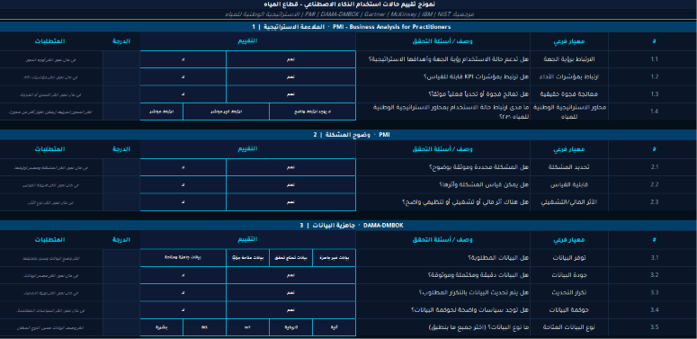

# Excel Use Case Assessment & Automation

### From scattered spreadsheets to an interactive assessment workflow

An Excel and VBA solution that combines use case selection, structured assessment, record management, and summary-card generation in one workbook.

## The Problem

The original workflow was split across two files and a wide table of use cases and assessment criteria. Finding information and updating evaluations required navigating many columns and repeating data entry.

## The Solution

Reorganized the workflow into an application-like Excel interface. Users choose a use case, enter its details, select assessment responses, review calculated results, and generate a linked card. VBA manages the interactions and record updates, while worksheet formulas connect the assessment and output views.

## Interface Preview

### Assessment Criteria

### Linked Use Case Card

*Displayed without populated records to protect confidential information.*

## Development Highlights

- Consolidated a two-file process into one workbook with dedicated assessment, card, reference-settings, and record-storage sheets.
- Created response cards with double-click selection, color feedback, and single-choice or multiple-choice behavior.
- Implemented cascading dropdowns for main category, subcategory, use case, and identifier.
- Linked names and identifiers in both directions to retrieve the selected use case.
- Connected assessment inputs and calculated priority to a summary card.
- Implemented record creation or updating in an internal worksheet table, plus restoration of saved responses, notes, and selected options.
- Added PDF and PNG card export procedures with generated file names and invalid-character cleanup.

## Features

| Feature | Function |
| --- | --- |
| Cascading dropdowns | Filter related options as the category changes |
| Dynamic reference lists | Read to the last populated source row and remove duplicate options |
| Interactive choices | Double-click to select or clear answers with color feedback |
| Multiple selections | Supported for configured questions and a designated dropdown field |
| Structured assessment | 33 criteria across eight evaluation areas |
| Automated scoring | Calculate points, percentage, decision category, and priority |
| Explained outcomes | Display the score basis and threshold legend |
| Contextual guidance | Clear hints when entering a field and restore them if left blank |
| Clean answer storage | Exclude guidance text from stored responses |
| Record retrieval | Create or update a use case record and restore its evaluation |
| Linked summary card | Populate the card from assessment data and priority |
| Export options | PDF fitted to one page and PNG output |
| Reset procedures | Clear the form or reset response selections |

### Evaluation Areas

Strategic fit, problem clarity, data readiness, technical feasibility, expected return, risk and compliance, organizational readiness, and priority/urgency.

## Workflow

1. Select a main category and subcategory, then choose a use case or its identifier.
2. Enter the description, objectives, expected impact, and supporting details.
3. Select assessment responses and add notes or evidence.
4. Review the score, decision category, priority, and score basis.
5. Open the linked card and export it as PDF or PNG.
6. Return to a use case to retrieve its saved evaluation.

Record updates occur inside the workbook. Saving the Excel file to disk remains a separate operation.

## Technologies

| Tool | Purpose |
| --- | --- |
| Microsoft Excel | Form interface, formulas, validation, reference lists, and record storage |
| VBA | Event-driven interactions, dependent lists, record handling, and exports |
| PDF and PNG | Export formats supported by the workbook |

## Practical Value

- Reduces repeated entry by linking the assessment and summary card.
- Makes individual records easier to access than navigating a wide source table.
- Standardizes evaluation criteria, scoring, and output presentation.
- Uses an existing desktop Excel environment without a separate hosted application or database service.

## Viewing the Project

The images are static interface previews. Features were reviewed from workbook formulas and VBA procedures; macros were not executed during repository preparation.
